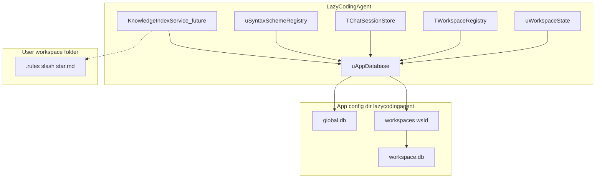

# LazyCodingAgent — Embedded Storage and Vector Search

Author: Attila Olbrich  
Date: 9 October 2026  
Status: Architecture and migration plan for a later implementation sprint. Not implemented in the application yet.

## Relation to the main future plan

This document **selects** storage and retrieval options that remain open in [Lazarus_AI_Agent_Future_Plan.md](Lazarus_AI_Agent_Future_Plan.md) (especially section 7, Workspace Knowledge Base). It also covers **replacing scattered INI/JSON app persistence** with a single embedded database engine so configuration, workspace registry, chat history, syntax schemes, and (later) RAG indexes share one cross-platform packaging story.

Guiding principles (aligned with the main roadmap): **embedded, cross-platform, observable migrations, minimal runtime dependencies.**

---

## 1. Goals

1. **No external SQLite shared library** — users must not install or ship `sqlite3.dll`, `libsqlite3.so`, or a separate `.dylib`. The SQLite engine is compiled into the LazyCodingAgent executable per OS/CPU.
2. **Unify app persistence** — migrate all application config under `GetAppConfigDir` from INI and JSON files into SQLite, with one-time importers and rollback-friendly legacy backups.
3. **Prepare for RAG** — reserve schema and retrieval strategy in the same workspace database: FTS5 keyword search plus in-process vector rerank (Phase A); optional ANN extension only if profiling requires it (Phase B).
4. **Keep user-owned text on disk** — project rules (`.rules/*.md`), agent plans (`.plan/*.md`), and repository source stay files; do not force them into the DB for editability and git workflows.

---

## 2. Current persistence inventory

| Source | Unit | Path / pattern | Contents |
| --- | --- | --- | --- |
| App settings | `uWorkspaceState.pas` | `GetAppConfigFile(False)` (INI) | Theme, agent mode/model, workspace name/root/active id, LLM provider settings (`LLM_CONFIG_VERSION = 3`), per-provider API keys and base URLs, saved model lists, panel visibility/floating/bounds/docked height, debugging mode |
| Workspace registry | `uWorkspaceRegistry.pas` | `…/lazycodingagent/workspaces.json` | Workspace id, display name, folder path, last session id; includes `MigrateFromLegacyIni` |
| Chat sessions | `uChatSessionStore.pas` | `…/lazycodingagent/sessions/<workspaceId>.json` | Session metadata (title, dates, archived) and full message arrays (roles, content, tool calls, timestamps) |
| Syntax highlighting | `uSyntaxSchemeRegistry.pas` | `…/lazycodingagent/syntax-schemes.json` + `*.json` files | Scheme index and per-scheme JSON (built-in generic scheme seeded on disk) |

**Explicitly out of scope for SQLite replacement**

- `<workspace>/.rules/*.md` — project rules for the agent (`uAgentRules.pas`).
- `<workspace>/.plan/*.md` — plan files created by tools.
- Application help under `help/` (shipped beside the executable).
- Third-party terminal config: `third_party/TerminalEmulator/.../TermFpGUI.Config.pas` (`termfpgui.ini`) unless explicitly unified in a separate effort.

---

## 3. Target architecture



### 3.1 Central database layer

Introduce **`uAppDatabase`** (name tentative) responsible for:

- Opening/creating databases under `IncludeTrailingPathDelimiter(GetAppConfigDir(False)) + 'lazycodingagent'`.
- Applying pragmas: `journal_mode=WAL`, `foreign_keys=ON`, sensible `busy_timeout`.
- Running **`schema_migrations`** in order inside transactions.
- Exposing thin repositories used by existing store classes (keep public APIs of `TWorkspaceState`, `TWorkspaceRegistry`, `TChatSessionStore`, `TSyntaxSchemeRegistry` stable where possible).

Error logging should follow the same config root as `uAgentToolErrorLog.pas`.

### 3.2 On-disk layout

**Global database:** `…/lazycodingagent/global.db`

- App-wide settings, workspace registry, LLM provider/model catalog, syntax scheme catalog (and optionally scheme JSON bodies — see open questions).

**Per-workspace database:** `…/lazycodingagent/workspaces/<wsId>/workspace.db`

- Chat sessions and messages for that workspace id.
- Future RAG tables (sources, documents, chunks, embeddings, ingest jobs).

**Why under config dir, not inside the user’s repo folder**

- Avoids polluting git workspaces and matches today’s session JSON layout under `lazycodingagent/sessions/`.
- Workspace identity remains tied to normalized folder path in `global.db`; deleting a workspace entry can remove `workspaces/<wsId>/` as a unit.

---

## 4. Embedded SQLite (static, no DLL/SO)

### 4.1 Source and licensing

- Vendor the **official SQLite amalgamation** (`sqlite3.c`, `sqlite3.h`) under `third_party/sqlite/` with a pinned version file (e.g. `VERSION.txt`) and the SQLite blessing/public-domain notice in project third-party credits.
- Do **not** depend on the system SQLite package at runtime.

### 4.2 Build flags (compile time)

Recommended defines when building the amalgamation:

| Flag | Purpose |
| --- | --- |
| `SQLITE_ENABLE_FTS5` | Keyword search for RAG and optional chat search |
| `SQLITE_THREADSAFE=1` | UI thread + background ingest jobs |
| `SQLITE_ENABLE_JSON1` | Optional JSON helpers in SQL (not required if Pascal handles JSON) |

Runtime: enable WAL for concurrent readers during long writes.

### 4.3 Linking in Free Pascal / Lazarus

- Compile `sqlite3.c` to a **platform object file** (`.o` / `.obj`) per target: Windows win32/win64, Linux x86_64/aarch64, macOS x86_64/aarch64.
- Link from a small Lazarus package (e.g. **`LazySqliteStatic`**) using FPC `{$L sqlite3.o}` (or per-CPU subfolders), **not** the default SQLdb dynamic loader (`sqlite3dyn`) that searches for `sqlite3.dll` / `libsqlite3.so`.
- Application project [`lazycodingagent.lpi`](../lazycodingagent.lpi) adds **`SQLdb`** + the static package; connection via `TSQLite3Connection` wired to static symbols.

Reference patterns (external): mORMot `SynSQLite3Static`, FPC “C in Free Pascal” object linking; evaluate one approach and document it in README when implemented.

### 4.4 Build scripts and CI

- Add **`scripts/build-sqlite-static.sh`** (and Windows build notes or `.bat`) mirroring the optional-deps pattern of [`scripts/build-terminal-deps.sh`](../scripts/build-terminal-deps.sh).
- Either commit prebuilt `.o` per supported platform or compile amalgamation on each `lazbuild` host.
- **macOS:** static third-party object code affects signing/notarization — same pipeline as other native objects; no separate SQLite dylib to notarize.

### 4.5 Deployment outcome

| Shipped to user | Not shipped |
| --- | --- |
| LazyCodingAgent executable (includes SQLite) | `sqlite3.dll`, `libsqlite3.so`, Homebrew SQLite |
| `global.db`, `workspace.db` files under config | — |

---

## 5. Schema sketches

Schema version starts at **1**; bump via `schema_migrations` only (never ad-hoc `ALTER` without a migration row).

### 5.1 Global DB

```sql
CREATE TABLE schema_migrations (
  version     INTEGER PRIMARY KEY,
  applied_at  TEXT NOT NULL
);

-- Normalized alternative to flat INI keys (preferred for typed fields)
CREATE TABLE app_settings (
  key   TEXT PRIMARY KEY,
  value TEXT NOT NULL,
  type  TEXT NOT NULL CHECK (type IN ('string','int','float','bool'))
);

CREATE TABLE workspaces (
  id              TEXT PRIMARY KEY,
  display_name    TEXT NOT NULL,
  folder_path     TEXT NOT NULL UNIQUE,
  last_session_id TEXT NOT NULL DEFAULT '',
  sort_order      INTEGER NOT NULL DEFAULT 0
);

CREATE TABLE llm_providers (
  provider_ord INTEGER PRIMARY KEY,
  api_key      TEXT NOT NULL DEFAULT '',
  base_url     TEXT NOT NULL DEFAULT ''
);

CREATE TABLE saved_models (
  provider_ord  INTEGER NOT NULL,
  seq           INTEGER NOT NULL,
  model_id      TEXT NOT NULL,
  display_name  TEXT NOT NULL,
  PRIMARY KEY (provider_ord, seq),
  FOREIGN KEY (provider_ord) REFERENCES llm_providers(provider_ord)
);

CREATE TABLE syntax_schemes (
  id          TEXT PRIMARY KEY,
  name        TEXT NOT NULL,
  built_in    INTEGER NOT NULL DEFAULT 0,
  json_body   TEXT NOT NULL,
  updated_at  TEXT NOT NULL
);

CREATE TABLE panel_layout (
  panel_ord       INTEGER PRIMARY KEY,
  visible         INTEGER NOT NULL,
  floating        INTEGER NOT NULL,
  left_pos        INTEGER NOT NULL,
  top_pos         INTEGER NOT NULL,
  width           INTEGER NOT NULL,
  height          INTEGER NOT NULL,
  docked_height   INTEGER NOT NULL DEFAULT 0
);
```

Active LLM provider, temperature, max tokens/steps, theme, agent mode, debugging flag, and active workspace id can live in `app_settings` or dedicated columns on a singleton `app_state` row — implementers should pick one style and stay consistent.

### 5.2 Per-workspace DB

```sql
CREATE TABLE schema_migrations (
  version     INTEGER PRIMARY KEY,
  applied_at  TEXT NOT NULL
);

CREATE TABLE sessions (
  id           TEXT PRIMARY KEY,
  title        TEXT NOT NULL,
  created_at   TEXT NOT NULL,
  modified_at  TEXT NOT NULL,
  archived     INTEGER NOT NULL DEFAULT 0,
  archived_at  TEXT
);

CREATE TABLE messages (
  session_id        TEXT NOT NULL,
  seq               INTEGER NOT NULL,
  role              TEXT NOT NULL,
  content           TEXT NOT NULL,
  tool_call_id      TEXT NOT NULL DEFAULT '',
  tokens_used       INTEGER NOT NULL DEFAULT 0,
  visual_summary    TEXT NOT NULL DEFAULT '',
  tool_calls_json   TEXT NOT NULL DEFAULT '[]',
  created_at        TEXT NOT NULL,
  PRIMARY KEY (session_id, seq),
  FOREIGN KEY (session_id) REFERENCES sessions(id) ON DELETE CASCADE
);

CREATE TABLE session_prefs (
  key   TEXT PRIMARY KEY,
  value TEXT NOT NULL
);
-- e.g. last_active_session_id mirroring JSON root field today
```

### 5.3 Future RAG tables (workspace DB)

Implement with section 7 of the main future plan; define schema early to avoid migration churn.

```sql
CREATE TABLE knowledge_sources (
  id            TEXT PRIMARY KEY,
  kind          TEXT NOT NULL,
  uri           TEXT NOT NULL,
  config_json   TEXT NOT NULL DEFAULT '{}',
  enabled       INTEGER NOT NULL DEFAULT 1,
  updated_at    TEXT NOT NULL
);

CREATE TABLE documents (
  id              TEXT PRIMARY KEY,
  source_id       TEXT NOT NULL,
  title           TEXT NOT NULL,
  loc             TEXT NOT NULL,
  content_hash    TEXT NOT NULL,
  fetched_at      TEXT NOT NULL,
  FOREIGN KEY (source_id) REFERENCES knowledge_sources(id) ON DELETE CASCADE
);

CREATE TABLE chunks (
  id              TEXT PRIMARY KEY,
  document_id     TEXT NOT NULL,
  chunk_index     INTEGER NOT NULL,
  text            TEXT NOT NULL,
  loc_detail      TEXT NOT NULL DEFAULT '',
  content_hash    TEXT NOT NULL,
  FOREIGN KEY (document_id) REFERENCES documents(id) ON DELETE CASCADE
);

CREATE VIRTUAL TABLE chunks_fts USING fts5(
  text,
  content='chunks',
  content_rowid='rowid'
);

CREATE TABLE chunk_embeddings (
  chunk_id        TEXT PRIMARY KEY,
  model_id        TEXT NOT NULL,
  dim             INTEGER NOT NULL,
  normalized      INTEGER NOT NULL DEFAULT 1,
  embedding_blob  BLOB NOT NULL,
  FOREIGN KEY (chunk_id) REFERENCES chunks(id) ON DELETE CASCADE
);

CREATE TABLE ingest_jobs (
  id            TEXT PRIMARY KEY,
  source_id     TEXT,
  status        TEXT NOT NULL,
  cursor_json   TEXT NOT NULL DEFAULT '{}',
  error_message TEXT NOT NULL DEFAULT '',
  cancelled     INTEGER NOT NULL DEFAULT 0,
  updated_at    TEXT NOT NULL
);
```

FTS5 sync triggers (insert/update/delete on `chunks`) should be added in the migration that creates `chunks_fts`.

---

## 6. Migration strategy

**Scope (accepted):** all app config — INI, `workspaces.json`, session JSON (metadata + messages), syntax scheme index and files.

### 6.1 Phases

| Phase | Deliverable |
| --- | --- |
| **M0 — Foundation** | `uAppDatabase`, migrations, static SQLite package, open global + workspace DBs |
| **M1 — Read-through** | If DB missing or empty, load legacy INI/JSON; on successful save, write SQLite |
| **M2 — Importers** | One-shot import: INI → global tables; `workspaces.json` → `workspaces`; each `sessions/<wsId>.json` → workspace DB; syntax schemes → `syntax_schemes` |
| **M3 — Cutover** | Default backend SQLite; rename legacy files to `.bak` after verified import (never silent delete) |
| **M4 — Tests** | Temp-dir fixtures in `tests/` asserting row counts and sample fields post-import |

### 6.2 INI import notes

Preserve behavior from `uWorkspaceState.pas`:

- **`LLM_CONFIG_VERSION`** and upgrade path from version 1/2 (legacy single `LLM` section, `OLD_LLM_PROVIDER_CUSTOM_ORD`).
- **Panel terminal docked height:** one-time correction when `DockedHeight = 0` and `Height` between 120 and 500 (lines 542–545) — apply during import or first load from DB.
- **Provider/model sections:** map `Provider_<ord>` and `Models_<ord>` to `llm_providers` / `saved_models`.

### 6.3 Session JSON import

Reuse parsing from `uChatSessionStore.pas` (`MessageToJson` / `MessageFromJson` field names): `role`, `content`, `toolCallId`, `timestamp`, `tokensUsed`, `visualSummary`, `toolCalls` array.

Store `lastSessionId` from JSON root into `session_prefs` or `workspaces.last_session_id` in global DB.

### 6.4 Rollback and recovery

- After import, rename `*.ini`, `workspaces.json`, `sessions/*.json`, `syntax-schemes.json` to `*.bak` with timestamp suffix.
- Document manual recovery: quit app, remove `.db`, restore `.bak` names, restart (or env flag **`LAZYCODINGAGENT_LEGACY_STORAGE=1`** — proposed — to force legacy readers during support).
- Optional future menu: **Export settings** to JSON archive for support.

### 6.5 Syntax schemes (v1 recommendation)

**Store full scheme JSON in `syntax_schemes.json_body`** in global DB; stop writing per-id files under `syntax-schemes/` after migration (or keep files as export-only). Built-in generic scheme becomes a seeded migration row. Import existing files on first run.

---

## 7. Vector and RAG retrieval strategy

Aligns with [Lazarus_AI_Agent_Future_Plan.md](Lazarus_AI_Agent_Future_Plan.md) section 7. **No separate vector database server** in either phase.

### 7.1 Phase A — default (minimal dependencies)

| Piece | Approach |
| --- | --- |
| Document/chunk store | Workspace DB tables above |
| Keyword recall | **FTS5** on chunk text |
| Embeddings | **`float32` BLOB** in `chunk_embeddings`; fixed `dim` per model |
| Semantic rank | **In-process** cosine similarity (or dot product on L2-normalized vectors) over FTS candidates only |
| Hybrid flow | FTS query → limit **N** candidates (e.g. 200–1000) → vector top-K → optional MMR/dedupe by file in Pascal |
| Embedding generation | External to SQLite: configurable local or cloud embedding API; store `model_id` + `content_hash` for invalidation |

**Expected scale:** adequate for typical single-workspace corpora (roughly thousands to low tens of thousands of chunks) when candidate set is pre-filtered.

### 7.2 Phase B — if profiling fails Phase A

Decision gate (indicative — tune with real hardware):

- More than **~50k chunks** per workspace, or
- **p95 retrieve latency > ~200 ms** on reference machine with Phase A.

Then add **one** of:

1. **sqlite-vec** compiled into the same static SQLite build (preferred: one native stack), or  
2. **USearch** (or similar) as a second static library with HNSW index files or memory index.

Do not add Chroma, Qdrant, Milvus, or Docker sidecars for the desktop app.

### 7.3 Retrieval API (future code)

- Single **workspace knowledge service** used by context assembly and agent tools (`search_knowledge`, `get_document`, `list_knowledge_sources`).
- Return citations: source id, path/URL, title, chunk id, excerpt, content hash / version.

---

## 8. Security and secrets

Today API keys live in plain INI (`Provider_*` sections). Moving to SQLite **does not** by itself improve secrecy; the DB file is user-readable on disk.

| v1 | Follow-up |
| --- | --- |
| Same practical security as INI (file permissions under user config dir) | OS credential store (Windows Credential Manager, macOS Keychain, libsecret on Linux) for API keys with SQLite holding non-secret prefs only |
| Document backup/export implications | Optional SQLCipher / encryption appendix — **non-goal for v1** (see below) |

---

## 9. Application integration map (implementation epics)

Ordered checklist for a later sprint (no code in this document task):

1. **`third_party/sqlite/`** + **`LazySqliteStatic`** package + build script(s).
2. **`uAppDatabase.pas`** — connections, migrations, pragmas.
3. **`uWorkspaceState`** — replace `TIniFile` Load/Save with repository.
4. **`uWorkspaceRegistry`** — DB backend; retain legacy JSON import.
5. **`uChatSessionStore`** — SQL for sessions/messages; remove dependency on per-workspace JSON file at cutover.
6. **`uSyntaxSchemeRegistry`** — load/save from `syntax_schemes` table.
7. **Startup migration orchestrator** — run importers once, `.bak` legacy files.
8. **Tests** — importer fixtures; optional in-memory SQLite for unit tests if static link allows.
9. **Help** — when shipping: update [`help/`](../help/) and [`help/index.json`](../help/index.json) (storage location, backup/recovery).
10. **RAG** — ingest jobs, FTS, embeddings, hybrid search (main future plan §7).

| Area | File |
| --- | --- |
| Project deps | `lazycodingagent.lpi` |
| Settings | `uWorkspaceState.pas`, `frmSettings.pas` |
| Workspaces | `uWorkspaceRegistry.pas` |
| Chat | `uChatSessionStore.pas` |
| Syntax | `uSyntaxSchemeRegistry.pas` |
| Future RAG | new units (e.g. `uKnowledgeIndex.pas`, `uVectorMath.pas`) |

---

## 10. Non-goals

- Replacing `.rules/*.md`, `.plan/*.md`, or project source with SQLite.
- External database or vector **services** (client/server).
- **SQLCipher / wxSQLite3** encryption in v1.
- Unifying **TermFpGUI** terminal INI with app DB.
- Proving full macOS/Linux CI in this document (README already notes platform verification gaps).

---

## 11. Open questions

Resolve during implementation planning:

1. **Singleton `app_state` row vs key-value `app_settings`** for theme, mode, active provider — affects query ergonomics vs INI parity.
2. **Syntax schemes:** DB-only JSON vs hybrid export files for user editing (v1 recommendation: DB-primary with optional export).
3. **Chat export:** whether users need JSON/Markdown export of sessions after SQL cutover (support/debugging).
4. **Workspace DB path:** confirm `workspaces/<wsId>/workspace.db` vs optional mirror under workspace folder for user-visible backup.
5. **Prebuilt `.o` artifacts in git** vs compile-on-build (repo size vs contributor friction).
6. **Phase B trigger metrics** — capture baseline on Windows/Linux/macOS reference devices during RAG beta.

---

## 12. Summary

LazyCodingAgent should use **statically embedded SQLite** for all app-level persistence currently spread across INI and JSON, with **per-workspace databases** for chat and future knowledge indexes. **FTS5 plus in-process vector rerank** delivers effective RAG with minimal dependencies; **sqlite-vec or USearch** remains optional until scale or latency requires it. User-facing Markdown in the repo stays on the filesystem; migrations must be **visible, reversible, and testable**.
