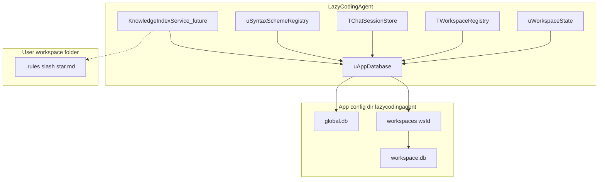

# LazyCodingAgent — Embedded Storage and Vector Search

Author: Attila Olbrich  
Date: 9 October 2026 (implementation status updated October 2026)  
Status: Architecture and migration plan. **M0 + global SQLite config are implemented**; chat/syntax SQLite wiring and RAG remain. **No** INI/JSON importers or legacy read-through (see [`sqlite/README.md`](sqlite/README.md)).

## Implementation status (landed)

| Item | Location | Notes |
| --- | --- | --- |
| Vendored amalgamation (FTS5 compile flags) | `third_party/sqlite/` | Built via `scripts/build-sqlite-static.*` |
| Static link package | `packages/LazySqliteStatic/` | `uSqlite3Embed.pas` + `{$L sqlite3_embed.o}`; **not** system `libsqlite3` |
| Connections + migrations v1–v2 (global) | `uAppDatabase.pas` | `global.db`, `workspaces/<wsId>/workspace.db`; pragmas WAL / foreign_keys |
| Repository ports | `data/uRepositoryInterfaces.pas`, `data/sqlite/*` | Settings, registry, LLM, panels, web search, browser read |
| Startup | `lazycodingagent.lpr`, `data/uGlobalConfigBootstrap.pas` | Opens `global.db` before main form |
| Stores on SQLite | `uWorkspaceState.pas`, `uWorkspaceRegistry.pas` | Load/Save via repositories in `global.db` |
| Tests | `tests/test_app_database.*`, `tests/test_settings_import.lpr` | Schema v2 + repository round-trip (CI) |
| Agent / IDE conventions | `.cursor/rules/persistence-and-data-access.mdc` | Repositories; future `IKnowledgeBackend` / `IBrainBackend` |
| Build / IDE | `scripts/install-lazarus-sqlite.*`, `lazycodingagent.lpi` **Libraries** | Run install script before first build |

**Deferred from original M0 sketch:** `TSQLite3Connection` / SQLdb — uses the minimal C API in `uSqlite3Embed` to avoid `sqlite3dyn`.

**Still on JSON files:** `uChatSessionStore.pas` (sessions), `uSyntaxSchemeRegistry.pas` (syntax schemes). **Post-M0 hygiene:** split global vs workspace migration DDL (workspace DB currently receives global v2 tables — see [`sqlite/m0-foundation.md`](sqlite/m0-foundation.md)).

## Relation to the main future plan

This document **selects** storage and retrieval options that remain open in [Lazarus_AI_Agent_Future_Plan.md](Lazarus_AI_Agent_Future_Plan.md) (especially section 7, Workspace Knowledge Base). It also covers **replacing scattered INI/JSON app persistence** with a single embedded database engine so configuration, workspace registry, chat history, syntax schemes, and (later) RAG indexes share one cross-platform packaging story.

Guiding principles (aligned with the main roadmap): **embedded, cross-platform, observable migrations, minimal runtime dependencies.**

---

## 1. Goals

1. **No external SQLite shared library** — users must not install or ship `sqlite3.dll`, `libsqlite3.so`, or a separate `.dylib`. The SQLite engine is compiled into the LazyCodingAgent executable per OS/CPU.
2. **Unify app persistence** — store application config under `GetAppConfigDir` in SQLite (`global.db` and per-workspace `workspace.db`). Recovery is backup/restore of database files ([`help/app-data-storage.md`](../help/app-data-storage.md)); no INI/JSON import path.
3. **Prepare for RAG** — reserve schema and retrieval strategy in the same workspace database: FTS5 keyword search plus in-process vector rerank (Phase A); optional ANN extension only if profiling requires it (Phase B).
4. **Keep user-owned text on disk** — project rules (`.rules/*.md`), agent plans (`.plan/*.md`), and repository source stay files; do not force them into the DB for editability and git workflows.

---

## 2. Current persistence inventory

| Source | Unit | Path / pattern | Contents |
| --- | --- | --- | --- |
| App settings + registry | `uWorkspaceState.pas`, `uWorkspaceRegistry.pas` | `…/lazycodingagent/global.db` | Theme, agent mode/model, LLM providers/models, panel layout, web search, browser read prefs, workspace list and active id (`LLM_CONFIG_VERSION` in `app_settings`) |
| Chat sessions | `uChatSessionStore.pas` | `…/lazycodingagent/sessions/<workspaceId>.json` | Session metadata and messages (SQLite migration pending — [`sqlite/m1-read-through-chat-sessions.md`](sqlite/m1-read-through-chat-sessions.md)) |
| Syntax highlighting | `uSyntaxSchemeRegistry.pas` | `…/lazycodingagent/syntax-schemes.json` + `*.json` files | Scheme index and bodies (SQLite migration pending — [`sqlite/m1-read-through-syntax-schemes.md`](sqlite/m1-read-through-syntax-schemes.md)) |

**Explicitly out of scope for SQLite replacement**

- `<workspace>/.rules/*.md` — project rules for the agent (`uAgentRules.pas`).
- `<workspace>/.plan/*.md` — plan files created by tools.
- Application help under `help/` (shipped beside the executable).
- Third-party terminal config: `third_party/TerminalEmulator/.../TermFpGUI.Config.pas` (`termfpgui.ini`) unless explicitly unified in a separate effort.

---

## 3. Target architecture



### 3.1 Central database layer

Introduce **`uAppDatabase`** (name tentative) responsible for:

- Opening/creating databases under `IncludeTrailingPathDelimiter(GetAppConfigDir(False)) + 'lazycodingagent'`.
- Applying pragmas: `journal_mode=WAL`, `foreign_keys=ON`, sensible `busy_timeout`.
- Running **`schema_migrations`** in order inside transactions.
- Exposing thin repositories used by existing store classes (keep public APIs of `TWorkspaceState`, `TWorkspaceRegistry`, `TChatSessionStore`, `TSyntaxSchemeRegistry` stable where possible).

Error logging should follow the same config root as `uAgentToolErrorLog.pas`.

### 3.2 On-disk layout

**Global database:** `…/lazycodingagent/global.db`

- App-wide settings, workspace registry, LLM provider/model catalog, syntax scheme catalog (and optionally scheme JSON bodies — see open questions).

**Per-workspace database:** `…/lazycodingagent/workspaces/<wsId>/workspace.db`

- Chat sessions and messages for that workspace id.
- Future RAG tables (sources, documents, chunks, embeddings, ingest jobs).

**Why under config dir, not inside the user’s repo folder**

- Avoids polluting git workspaces and matches today’s session JSON layout under `lazycodingagent/sessions/`.
- Workspace identity remains tied to normalized folder path in `global.db`; deleting a workspace entry can remove `workspaces/<wsId>/` as a unit.

---

## 4. Embedded SQLite (static, no DLL/SO)

### 4.1 Source and licensing

- Vendor the **official SQLite amalgamation** (`sqlite3.c`, `sqlite3.h`) under `third_party/sqlite/` with a pinned version file (e.g. `VERSION.txt`) and the SQLite blessing/public-domain notice in project third-party credits.
- Do **not** depend on the system SQLite package at runtime.

### 4.2 Build flags (compile time)

Recommended defines when building the amalgamation:

| Flag | Purpose |
| --- | --- |
| `SQLITE_ENABLE_FTS5` | Keyword search for RAG and optional chat search |
| `SQLITE_THREADSAFE=1` | UI thread + background ingest jobs |
| `SQLITE_ENABLE_JSON1` | Optional JSON helpers in SQL (not required if Pascal handles JSON) |

Runtime: enable WAL for concurrent readers during long writes.

### 4.3 Linking in Free Pascal / Lazarus

- Compile `sqlite3.c` to a **platform object file** (`.o` / `.obj`) per target: Windows win32/win64, Linux x86_64/aarch64, macOS x86_64/aarch64.
- Link from a small Lazarus package (e.g. **`LazySqliteStatic`**) using FPC `{$L sqlite3.o}` (or per-CPU subfolders), **not** the default SQLdb dynamic loader (`sqlite3dyn`) that searches for `sqlite3.dll` / `libsqlite3.so`.
- Application project [`lazycodingagent.lpi`](../lazycodingagent.lpi) adds **`SQLdb`** + the static package; connection via `TSQLite3Connection` wired to static symbols.

Reference patterns (external): mORMot `SynSQLite3Static`, FPC “C in Free Pascal” object linking; evaluate one approach and document it in README when implemented.

### 4.4 Build scripts and CI

- Add **`scripts/build-sqlite-static.sh`** (and Windows build notes or `.bat`) mirroring the optional-deps pattern of [`scripts/build-terminal-deps.sh`](../scripts/build-terminal-deps.sh).
- Either commit prebuilt `.o` per supported platform or compile amalgamation on each `lazbuild` host.
- **macOS:** static third-party object code affects signing/notarization — same pipeline as other native objects; no separate SQLite dylib to notarize.

### 4.5 Deployment outcome

| Shipped to user | Not shipped |
| --- | --- |
| LazyCodingAgent executable (includes SQLite) | `sqlite3.dll`, `libsqlite3.so`, Homebrew SQLite |
| `global.db`, `workspace.db` files under config | — |

---

## 5. Schema sketches

Schema version starts at **1**; bump via `schema_migrations` only (never ad-hoc `ALTER` without a migration row).

### 5.1 Global DB

```sql
CREATE TABLE schema_migrations (
  version     INTEGER PRIMARY KEY,
  applied_at  TEXT NOT NULL
);

-- Normalized alternative to flat INI keys (preferred for typed fields)
CREATE TABLE app_settings (
  key   TEXT PRIMARY KEY,
  value TEXT NOT NULL,
  type  TEXT NOT NULL CHECK (type IN ('string','int','float','bool'))
);

CREATE TABLE workspaces (
  id              TEXT PRIMARY KEY,
  display_name    TEXT NOT NULL,
  folder_path     TEXT NOT NULL UNIQUE,
  last_session_id TEXT NOT NULL DEFAULT '',
  sort_order      INTEGER NOT NULL DEFAULT 0
);

CREATE TABLE llm_providers (
  provider_ord INTEGER PRIMARY KEY,
  api_key      TEXT NOT NULL DEFAULT '',
  base_url     TEXT NOT NULL DEFAULT ''
);

CREATE TABLE saved_models (
  provider_ord  INTEGER NOT NULL,
  seq           INTEGER NOT NULL,
  model_id      TEXT NOT NULL,
  display_name  TEXT NOT NULL,
  PRIMARY KEY (provider_ord, seq),
  FOREIGN KEY (provider_ord) REFERENCES llm_providers(provider_ord)
);

CREATE TABLE syntax_schemes (
  id          TEXT PRIMARY KEY,
  name        TEXT NOT NULL,
  built_in    INTEGER NOT NULL DEFAULT 0,
  json_body   TEXT NOT NULL,
  updated_at  TEXT NOT NULL
);

CREATE TABLE panel_layout (
  panel_ord       INTEGER PRIMARY KEY,
  visible         INTEGER NOT NULL,
  floating        INTEGER NOT NULL,
  left_pos        INTEGER NOT NULL,
  top_pos         INTEGER NOT NULL,
  width           INTEGER NOT NULL,
  height          INTEGER NOT NULL,
  docked_height   INTEGER NOT NULL DEFAULT 0
);

CREATE TABLE web_search_connections (
  id                  TEXT PRIMARY KEY,
  name                TEXT NOT NULL,
  provider            TEXT NOT NULL,
  enabled             INTEGER NOT NULL,
  priority            INTEGER NOT NULL,
  timeout_ms          INTEGER NOT NULL,
  instance_url        TEXT NOT NULL DEFAULT '',
  tavily_search_depth TEXT NOT NULL DEFAULT 'basic',
  custom_header_name  TEXT NOT NULL DEFAULT '',
  custom_header_value TEXT NOT NULL DEFAULT '',
  api_key             TEXT NOT NULL DEFAULT ''
);
```

Active LLM provider, temperature, max tokens/steps, theme, agent mode, debugging flag, and active workspace id can live in `app_settings` or dedicated columns on a singleton `app_state` row — implementers should pick one style and stay consistent.

### 5.2 Per-workspace DB

```sql
CREATE TABLE schema_migrations (
  version     INTEGER PRIMARY KEY,
  applied_at  TEXT NOT NULL
);

CREATE TABLE sessions (
  id           TEXT PRIMARY KEY,
  title        TEXT NOT NULL,
  created_at   TEXT NOT NULL,
  modified_at  TEXT NOT NULL,
  archived     INTEGER NOT NULL DEFAULT 0,
  archived_at  TEXT
);

CREATE TABLE messages (
  session_id        TEXT NOT NULL,
  seq               INTEGER NOT NULL,
  role              TEXT NOT NULL,
  content           TEXT NOT NULL,
  tool_call_id      TEXT NOT NULL DEFAULT '',
  tokens_used       INTEGER NOT NULL DEFAULT 0,
  visual_summary    TEXT NOT NULL DEFAULT '',
  tool_calls_json   TEXT NOT NULL DEFAULT '[]',
  created_at        TEXT NOT NULL,
  PRIMARY KEY (session_id, seq),
  FOREIGN KEY (session_id) REFERENCES sessions(id) ON DELETE CASCADE
);

CREATE TABLE session_prefs (
  key   TEXT PRIMARY KEY,
  value TEXT NOT NULL
);
-- e.g. last_active_session_id mirroring JSON root field today
```

### 5.3 Future RAG tables (workspace DB)

Implement with section 7 of the main future plan; define schema early to avoid migration churn.

```sql
CREATE TABLE knowledge_sources (
  id            TEXT PRIMARY KEY,
  kind          TEXT NOT NULL,
  uri           TEXT NOT NULL,
  config_json   TEXT NOT NULL DEFAULT '{}',
  enabled       INTEGER NOT NULL DEFAULT 1,
  updated_at    TEXT NOT NULL
);

CREATE TABLE documents (
  id              TEXT PRIMARY KEY,
  source_id       TEXT NOT NULL,
  title           TEXT NOT NULL,
  loc             TEXT NOT NULL,
  content_hash    TEXT NOT NULL,
  fetched_at      TEXT NOT NULL,
  FOREIGN KEY (source_id) REFERENCES knowledge_sources(id) ON DELETE CASCADE
);

CREATE TABLE chunks (
  id              TEXT PRIMARY KEY,
  document_id     TEXT NOT NULL,
  chunk_index     INTEGER NOT NULL,
  text            TEXT NOT NULL,
  loc_detail      TEXT NOT NULL DEFAULT '',
  content_hash    TEXT NOT NULL,
  FOREIGN KEY (document_id) REFERENCES documents(id) ON DELETE CASCADE
);

CREATE VIRTUAL TABLE chunks_fts USING fts5(
  text,
  content='chunks',
  content_rowid='rowid'
);

CREATE TABLE chunk_embeddings (
  chunk_id        TEXT PRIMARY KEY,
  model_id        TEXT NOT NULL,
  dim             INTEGER NOT NULL,
  normalized      INTEGER NOT NULL DEFAULT 1,
  embedding_blob  BLOB NOT NULL,
  FOREIGN KEY (chunk_id) REFERENCES chunks(id) ON DELETE CASCADE
);

CREATE TABLE ingest_jobs (
  id            TEXT PRIMARY KEY,
  source_id     TEXT,
  status        TEXT NOT NULL,
  cursor_json   TEXT NOT NULL DEFAULT '{}',
  error_message TEXT NOT NULL DEFAULT '',
  cancelled     INTEGER NOT NULL DEFAULT 0,
  updated_at    TEXT NOT NULL
);
```

FTS5 sync triggers (insert/update/delete on `chunks`) should be added in the migration that creates `chunks_fts`.

---

## 6. Migration strategy

**Scope:** SQLite schema migrations and repository wiring only. **No** one-shot INI/JSON importers, read-through dual backends, or `.bak` legacy file rename (cancelled — see [`sqlite/README.md`](sqlite/README.md)).

### 6.1 Phases

| Phase | Deliverable |
| --- | --- |
| **M0 — Foundation** | Static SQLite, `uAppDatabase`, first repositories, CI tests (**done**) |
| **M1 — Stores** | Global v2 tables + `uWorkspaceState` / `uWorkspaceRegistry` on SQLite (**done**); workspace chat schema + `uChatSessionStore`; `syntax_schemes` + `uSyntaxSchemeRegistry`; split global vs workspace migration runner |
| **M5 — Help** | User Guide storage topic ([`sqlite/m5-user-help-storage.md`](sqlite/m5-user-help-storage.md)) |
| **M6 — RAG** | Workspace knowledge tables, FTS5, hybrid retrieval |

### 6.2 Session message mapping (for M1 chat store)

Reuse field names from `uChatSessionStore.pas` (`MessageToJson` / `MessageFromJson`): `role`, `content`, `toolCallId`, `timestamp`, `tokensUsed`, `visualSummary`, `toolCalls` array. Persist `lastSessionId` in `session_prefs` or `workspaces.last_session_id`.

### 6.3 Recovery

- Quit the app; restore `global.db` from backup or remove it to reset application settings (workspace folders on disk are unchanged).
- When chat uses `workspace.db`, back up `…/workspaces/<wsId>/workspace.db` similarly.
- Optional future menu: **Export settings** archive for support.

### 6.4 Syntax schemes (v1 recommendation)

Store full scheme JSON in `syntax_schemes.json_body` in global DB; built-in generic scheme as a seeded migration row. Per-id files under `syntax-schemes/` optional as export-only after SQLite cutover.

---

## 7. Vector and RAG retrieval strategy

Aligns with [Lazarus_AI_Agent_Future_Plan.md](Lazarus_AI_Agent_Future_Plan.md) section 7. **No separate vector database server** in either phase.

### 7.1 Phase A — default (minimal dependencies)

| Piece | Approach |
| --- | --- |
| Document/chunk store | Workspace DB tables above |
| Keyword recall | **FTS5** on chunk text |
| Embeddings | **`float32` BLOB** in `chunk_embeddings`; fixed `dim` per model |
| Semantic rank | **In-process** cosine similarity (or dot product on L2-normalized vectors) over FTS candidates only |
| Hybrid flow | FTS query → limit **N** candidates (e.g. 200–1000) → vector top-K → optional MMR/dedupe by file in Pascal |
| Embedding generation | External to SQLite: configurable local or cloud embedding API; store `model_id` + `content_hash` for invalidation |

**Expected scale:** adequate for typical single-workspace corpora (roughly thousands to low tens of thousands of chunks) when candidate set is pre-filtered.

### 7.2 Phase B — if profiling fails Phase A

Decision gate (indicative — tune with real hardware):

- More than **~50k chunks** per workspace, or
- **p95 retrieve latency > ~200 ms** on reference machine with Phase A.

Then add **one** of:

1. **sqlite-vec** compiled into the same static SQLite build (preferred: one native stack), or  
2. **USearch** (or similar) as a second static library with HNSW index files or memory index.

Do not add Chroma, Qdrant, Milvus, or Docker sidecars for the desktop app.

### 7.3 Retrieval API (future code)

- Single **workspace knowledge service** used by context assembly and agent tools (`search_knowledge`, `get_document`, `list_knowledge_sources`).
- Return citations: source id, path/URL, title, chunk id, excerpt, content hash / version.

---

## 8. Security and secrets

App settings in `global.db` may store LLM and web-search API keys with **field-level AES-256-GCM** via `uSecurityManager` (OpenSSL), using key material embedded in the application binary. This is **obfuscation against casual disk inspection**, not protection against a determined analyst with the binary and database.

| v1 (settings cutover) | Follow-up |
| --- | --- |
| Encrypted secret columns; non-secrets in plain SQLite text | OS credential store (Windows Credential Manager, macOS Keychain, libsecret on Linux) with SQLite holding references only |
| Document backup/recovery in User Guide (`help/app-data-storage.md`) | Optional full-database SQLCipher — still **non-goal** (see below) |

---

## 9. Application integration map (implementation epics)

**Sprint order (one item per PR):** see [`future-plan/sqlite/README.md`](sqlite/README.md).

Ordered checklist (see [`sqlite/README.md`](sqlite/README.md) for **NEXT** item):

1. ~~**`third_party/sqlite/`** + **`LazySqliteStatic`** package + build script(s).~~ **Done.**
2. ~~**`uAppDatabase.pas`** — connections, migrations, pragmas; repository adapters.~~ **Done (global v2; split workspace migrations pending).**
3. ~~**`uWorkspaceState`** — SQLite repositories.~~ **Done.**
4. ~~**`uWorkspaceRegistry`** — SQLite backend.~~ **Done.**
5. ~~**Startup `global.db`** — `EnsureGlobalConfigReady`.~~ **Done.**
6. **`uChatSessionStore`** — SQL for sessions/messages in workspace DB.
7. **`uSyntaxSchemeRegistry`** — `syntax_schemes` table in global DB.
8. **Help** — update [`help/`](../help/) and [`help/index.json`](../help/index.json) (storage, backup/recovery).
9. **RAG** — ingest jobs, FTS, embeddings, hybrid search (main future plan §7).

| Area | File |
| --- | --- |
| Project deps | `lazycodingagent.lpi` |
| Settings | `uWorkspaceState.pas`, `frmSettings.pas` |
| Workspaces | `uWorkspaceRegistry.pas` |
| Chat | `uChatSessionStore.pas` |
| Syntax | `uSyntaxSchemeRegistry.pas` |
| Future RAG | new units (e.g. `uKnowledgeIndex.pas`, `uVectorMath.pas`) |
| M0 DB / repos | `uAppDatabase.pas`, `data/uRepositoryInterfaces.pas`, `data/sqlite/*`, `packages/LazySqliteStatic/` |
| Remote KB / Brain (future) | `data/remote/` — HTTP clients behind `IKnowledgeBackend` / `IBrainBackend` (see persistence Cursor rule) |

---

## 10. Non-goals

- Replacing `.rules/*.md`, `.plan/*.md`, or project source with SQLite.
- External database or vector **services** (client/server).
- **SQLCipher / wxSQLite3** encryption in v1.
- Unifying **TermFpGUI** terminal INI with app DB.
- Proving full macOS/Linux CI in this document (README already notes platform verification gaps).

---

## 11. Open questions

Resolve during implementation planning:

1. **Singleton `app_state` row vs key-value `app_settings`** for theme, mode, active provider — affects query ergonomics vs INI parity.
2. **Syntax schemes:** DB-only JSON vs hybrid export files for user editing (v1 recommendation: DB-primary with optional export).
3. **Chat export:** whether users need JSON/Markdown export of sessions after SQL cutover (support/debugging).
4. **Workspace DB path:** confirm `workspaces/<wsId>/workspace.db` vs optional mirror under workspace folder for user-visible backup.
5. **Prebuilt `.o` artifacts in git** vs compile-on-build — **M0 decision:** compile on build host (`build-sqlite-static.*` copies `sqlite3_embed.o` to `src/` and `lib/<cpu>-<os>/`); objects are gitignored.
6. **Phase B trigger metrics** — capture baseline on Windows/Linux/macOS reference devices during RAG beta.

---

## 12. Summary

LazyCodingAgent uses **statically embedded SQLite** for global app configuration today, with **per-workspace databases** for chat (in progress) and future knowledge indexes. **FTS5 plus in-process vector rerank** delivers effective RAG with minimal dependencies; **sqlite-vec or USearch** remains optional until scale or latency requires it. User-facing Markdown in the repo stays on the filesystem; schema migrations are **versioned and testable**; recovery is **database backup/restore**, not legacy file import.
